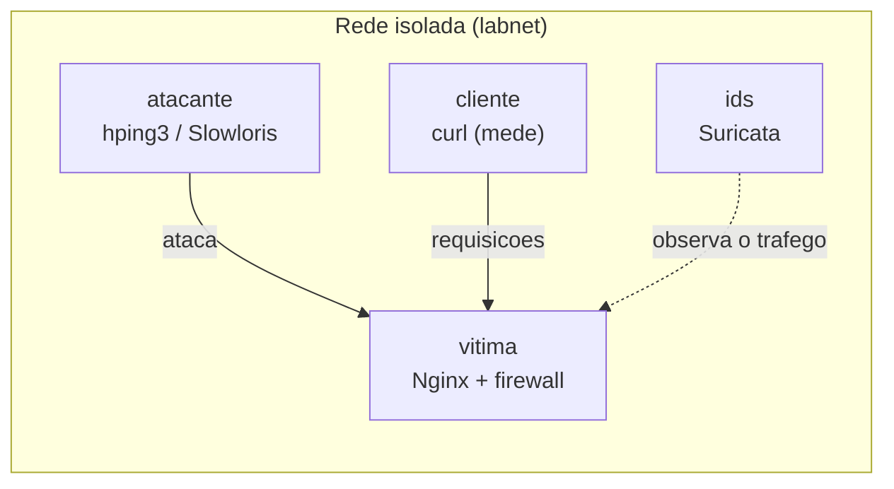
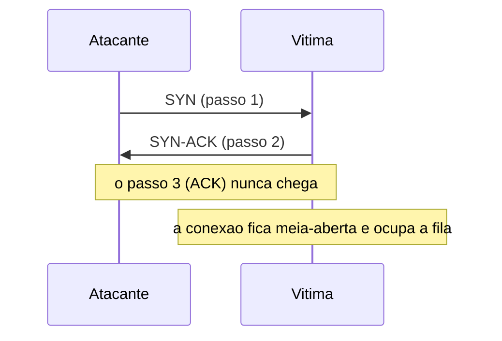
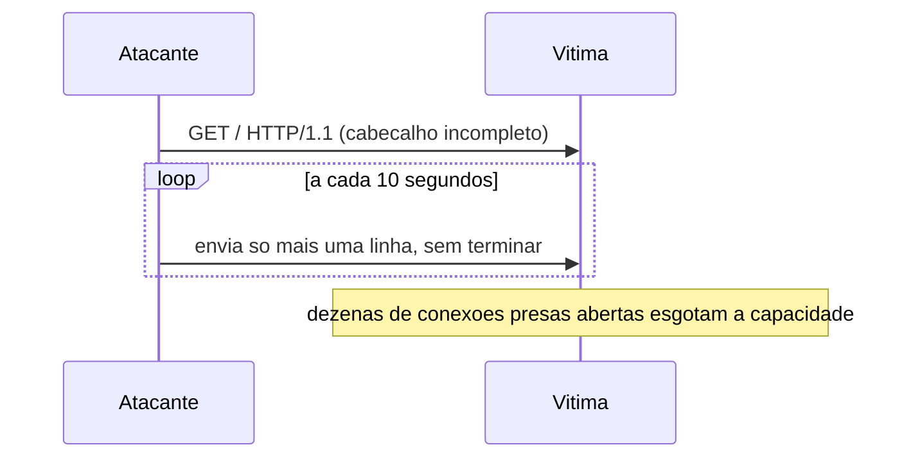

# Diagramas do laboratório

Estes diagramas usam Mermaid. Eles renderizam automaticamente no GitHub e no VS Code (com a extensão Mermaid). Para virar imagem de slide, abra em https://mermaid.live, cole o bloco e exporte como PNG.

## 1. Arquitetura do laboratório

## 2. SYN flood (ataque de rede)

## 3. Slowloris (ataque de aplicacao)

